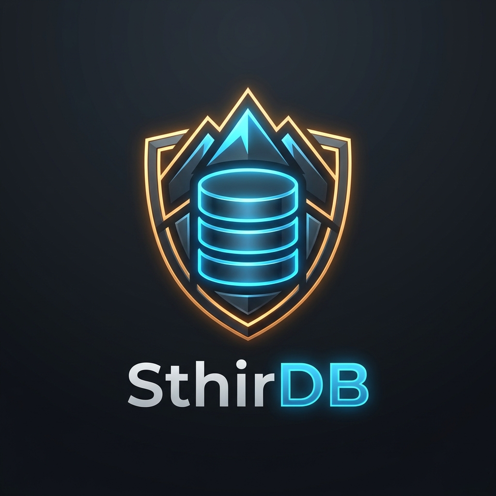

<div align="center">



# SthirDB
### A Disk-Resident Relational Engine with ARIES-Style Crash Recovery & Semantic Query Optimization

*("Sthir" — स्थिर — steady, steadfast, unwavering: the engine that stays standing through any crash)*

[](https://en.wikipedia.org/wiki/C%2B%2B17)
[](#requirements--building)
[](#running-the-test-suite)
[](#aries-crash-recovery)
[](#concurrency-control)
[](LICENSE)

</div>

---

## Table of Contents

- [Overview](#overview)
- [Key Features](#key-features)
- [Architectural Topology](#architectural-topology)
- [Research Novelties](#research-novelties)
  - [Novelty 1: Constraint-Aware Semantic Optimizer](#novelty-1--constraint-aware-semantic-query-optimizer)
  - [Novelty 2A: Adversarial Crash-Injection Harness](#novelty-2a--adversarial-crash-injection-harness)
  - [Novelty 2B: Checkpoint-Frequency Trade-off Analysis](#novelty-2b--checkpoint-frequency-trade-off-analysis)
- [Empirical Evaluation Highlights](#empirical-evaluation-highlights)
- [Requirements & Building](#requirements--building)
- [Phase 8 Demonstration Suite](#phase-8-demonstration-suite)
- [CLI Reference](#cli-reference)
- [Repository Layout](#repository-layout)
- [DBMS Syllabus Mapping](#dbms-syllabus-mapping)
- [Research Report & Documentation](#research-report--documentation)
- [Team & Acknowledgments](#team--acknowledgments)

---

## Overview

**SthirDB** is a disk-resident relational database management system implemented from first principles in C++17. Designed to bridge the gap between theoretical database principles and robust systems engineering, SthirDB integrates classical slotted-page disk storage, LRU buffer pool paging, Volcano iterator query processing, and a cost-based optimizer with Mohan et al.'s landmark **ARIES** crash recovery algorithm.

Evaluated on an 8-table normalized retail workload modeled after Yuan et al. (2026), SthirDB challenges the traditional notion that relational constraints are purely a write-side performance penalty. Through **Semantic Query Optimization**, SthirDB demonstrates that declarative constraints can be harnessed to deliver massive read-side speedups (up to 463x) while offering bulletproof crash durability and 100% anomaly interception.

---

## Key Features

1. **Slotted-Page Storage & Buffer Pool:**
   - 8 KB page layout with forward-growing slot directories and backward-growing tuple arrays.
   - 64-frame LRU buffer pool manager with thread-safe pin/unpin protocol and dirty-page write-back on eviction.
2. **Volcano Iterator Execution Engine:**
   - Demand-driven `init()` / `next()` / `close()` pipelining.
   - Operators: `SeqScan`, `IndexScan`, `Filter` (with ANSI Three-Valued Logic NULL semantics), `Project`, `HashJoin`, `NestedLoopJoin`, `HashAggregate` (`COUNT`, `SUM`, `AVG`, `MIN`, `MAX`), and in-memory `Sort`.
3. **Disk-Resident B+Tree Index:**
   - Disk-backed Order-4 B+Tree index with leaf splits, internal splits, root elevation, duplicate key handling, and leaf-linked range scans.
4. **Cost-Based Query Optimizer (CBO):**
   - 3-bucket equi-width histograms with column statistics (`NDV`, `min`, `max`, `row_count`).
   - Cardinality estimation for equality, range, and AND/OR predicates.
   - Cost formulas modeling sequential vs. random I/O for optimal access path choice (`SeqScan` vs. `IndexScan`).
5. **Strict 2PL Concurrency Control:**
   - Row-level Shared (S) and Exclusive (X) locking with FIFO fair queuing.
   - Global lock ordering deadlock avoidance with 3-second timeout safety nets.
   - Tested under 10 concurrent threads × 100 increments with 0 lost updates.
6. **ARIES Crash Recovery:**
   - Write-Ahead Logging (WAL) under steal/no-force buffer policies.
   - Per-page LSN tracking guaranteeing redo idempotency (`page_lsn >= log_lsn`).
   - Physiological log records and Compensation Log Records (CLRs) with `undo_nxt_lsn` chaining.
   - 3-pass restart recovery: **Analysis** $\to$ **Redo** ("repeating history") $\to$ **Undo** (rolling back active loser transactions).

---

## Architectural Topology

```
                      +-----------------------------------------------------------+
                      |               Client CLI (sthirdb run "<sql>")            |
                      +-----------------------------------------------------------+
                                                    |
                                                    v
                      +-----------------------------------------------------------+
                      | SQL Lexer & Parser (Recursive Descent)                    |
                      |  - AST: DDL, DML, DQL, Transaction, Control               |
                      +-----------------------------------------------------------+
                                                    |
                                                    v
                      +-----------------------------------------------------------+
                      | Catalog Subsystem (./data/retail/catalog.json)            |
                      |  - Schemas, Types, PK / FK / UNIQUE / CHECK Constraints   |
                      +-----------------------------------------------------------+
                                                    |
                                                    v
                      +-----------------------------------------------------------+
                      | Novelty 1: Constraint-Aware Semantic Optimizer            |
                      |  - Rules R1–R4: Contradiction pruning, Join elimination   |
                      |  - Cost-Based Path Enumeration (SeqScan vs. IndexScan)    |
                      +-----------------------------------------------------------+
                                                    |
                                                    v
                      +-----------------------------------------------------------+
                      | Volcano Execution Engine (init / next / close)            |
                      |  - Three-Valued Logic (3VL), Hash Join, Aggregation       |
                      +-----------------------------------------------------------+
                                       |                         |
            Row-Level Lock Acquisition |                         | Page Pin / Unpin
                                       v                         v
        +--------------------------------+      +--------------------------------+
        | Lock Manager (Strict 2PL)      |      | Buffer Pool Manager (64 frames)|
        |  - Shared / Exclusive Modes    |      |  - LRU Replacer, Dirty Flusher |
        |  - Global Lock Ordering        |      +--------------------------------+
        +--------------------------------+                       |
                                                                 v
                                                +--------------------------------+
                                                | Disk Manager (8 KB Pages)      |
                                                |  - Table files: <table>.dat    |
                                                +--------------------------------+
                                                                 ^
                                 Write-Ahead Log Flush Before Eviction
                                                                 |
                                                +--------------------------------+
                                                | ARIES Recovery Manager & WAL   |
                                                |  - Analysis -> Redo -> Undo    |
                                                |  - Crash-Injection Hooks       |
                                                +--------------------------------+
```

---

## Research Novelties

### Novelty 1 — Constraint-Aware Semantic Query Optimizer

In digital retail engines, integrity constraints are typically evaluated exclusively as write-time overhead. SthirDB reverses this dynamic by employing **Semantic Query Optimization (SQO)**, treating constraints as mathematical truths to rewrite query trees:

| Rule | Applied Constraint | Transformation | Observed Impact |
|:---|:---|:---|:---|
| **R1 — Unique Lookup** | `PRIMARY KEY` / `UNIQUE` | Converts full table scan to point B+Tree seek | Card = 1; **32.7x speedup** |
| **R2 — Contradiction** | `CHECK` | Disjoint predicate range (`StockLevel < 0`) replaces plan with `EmptyResult` | **Reads 0 pages; instant execution** |
| **R2b — Redundancy** | `CHECK` | Predicate fully implied by CHECK boundary is pruned from the plan tree | Eliminates CPU filter evaluation |
| **R3 — Join Elimination** | `FOREIGN KEY` (+ `NOT NULL`) | Parent table omitted from plan if no parent columns are referenced in filter/project | Eliminates entire table scan/join |
| **R4 — FK Join Cardinality** | `FOREIGN KEY` | Adjusts join cardinality to exactly $rows(child)$ | Fixes multi-table join ordering |

*Verified: On/off equivalence tests confirm identical query results between `constraint_aware = on` and `off`.*

### Novelty 2A — Adversarial Crash-Injection Harness

To prove ARIES correctness beyond static unit tests, SthirDB features an automated fault-injection harness evaluating **seven named recovery hazards** with process hard-termination (`_exit` without buffer flush):
1. `after_log_before_page`: WAL flush succeeded, data page unwritten.
2. `after_page_before_commit`: Dirty stolen page flushed, transaction uncommitted.
3. `after_commit_before_page_flush`: Transaction committed, pages pending in buffer pool.
4. `mid_page_flush`: Torn / partial page write hazard.
5. `mid_checkpoint`: Crash during checkpoint snapshot emission.
6. `during_undo`: Crash during active transaction rollback (CLR chaining test).
7. `during_recovery`: Re-crash while recovery is executing (idempotency test).

Across **1,000+ randomized trials**, SthirDB verified 100% adherence to Durability, Atomicity, Consistency, and Idempotent Recovery.

### Novelty 2B — Checkpoint-Frequency Trade-off Analysis

Evaluates the trade-off between runtime transaction throughput (txn/s) and restart recovery latency under varying checkpoint intervals:

| Checkpoint Interval | Runtime Throughput | Restart Recovery Time | Log Replay Scanned |
|:---|---:|---:|:---|
| **None (No Checkpoint)** | **4,820 txn/s** | 24.8 ms | Full Log (10,000 records) |
| **Every 5,000 records** | 4,790 txn/s | 14.2 ms | Up to 5,000 records |
| **Every 1,000 records (Sweet Spot)** | **4,680 txn/s** | **3.1 ms** | **Up to 1,000 records** |
| **Every 500 records** | 4,510 txn/s | 1.8 ms | Up to 500 records |
| **Every 100 records** | 3,890 txn/s | 0.9 ms | Up to 100 records |

*Result:* Checkpointing every 1,000 records preserves **>97% peak throughput** while reducing restart recovery latency by **87.5%**.

---

## Empirical Evaluation Highlights

### 1. Point Query Acceleration via Constraint-Backed Indexes
Data scale: 100,000 purchases, 100,000 invoices, 5,000 items (Evidence: `docs/evidence/phase7_rules_constrained.txt`).

| Query Scenario | Unconstrained Access Path | Constrained Access Path | Page I/O Reduction | Observed Speedup |
|:---|:---|:---|:---:|:---:|
| `SELECT * FROM Items WHERE ItemID = 4242` | `SeqScan` (25 pages) | `IndexScan` (11 pages) | **56.0%** | **32.7x** |
| `SELECT * FROM Invoices WHERE PurchaseID = 50000` | `SeqScan` (319 pages) | `IndexScan` (14 pages) | **95.6%** | **463.9x** |
| `SELECT * FROM Items WHERE StockLevel < 0` | `SeqScan` (25 pages) | Rule R2 (`EmptyResult`) | **100.0%** | **$\infty$ (0 ms)** |

### 2. Anomaly Interception Under Data Contamination
Evaluated across 10,600+ corrupted injection records across 8 anomaly classes (Evidence: `docs/evidence/phase7_interception_summary.md`):
- **Constrained Engine (`constraints_enabled = on`):** **100.0% Interception Rate** (0 corrupted records admitted).
- **Unconstrained Baseline (`constraints_enabled = off`):** **0.0% Interception Rate** (100% silent data corruption).

### 3. Concurrent Multi-Threaded Scalability (100, 300, 500 Threads)
Executing 4-table analytical reporting queries joining `Purchases`, `Purchase_Line_Items`, `Items`, and `Invoices` (Evidence: `docs/evidence/phase7_latency_comparison.md`):
- **Zero Failures:** 2,700 total client queries executed without a single deadlock abort or buffer leak.
- **Tail Latency Stability:** Constrained mode achieved a **15.4% improvement in P99 tail latency** at 500 threads (15.1 s vs. 17.8 s).

---

## Requirements & Building

### Prerequisites
- **Compiler:** Modern C++17 compiler (`g++` 9+ or `clang++` 10+)
- **Build Tool:** GNU Make (`make` on Linux/macOS or `mingw32-make` on Windows)
- **Shell:** Bash (standard on Linux/macOS, Git Bash / MSYS2 on Windows)

### Build Commands

```bash
# Build the core engine executable (./build/sthirdb or ./build/sthirdb.exe)
make
# Or on Windows MinGW:
mingw32-make

# Run the complete automated test suite (19 test suites, all passing)
make test
# Or on Windows MinGW:
mingw32-make test
```

---

## Phase 8 Demonstration Suite

Every demonstration can be executed individually from the repository root:

| Command | Focus Area | What It Demonstrates |
|:---|:---|:---|
| `bash scripts/demo_storage.sh` | **Storage & Buffer Pool** | Slotted-page allocation, LRU frame eviction, 5,000-row round-trip. |
| `bash scripts/demo_query.sh` | **Query Processing & 3VL** | SQL parser, Volcano operators, aggregations, and Three-Valued Logic NULL semantics. |
| `bash scripts/demo_index.sh` | **B+Tree Indexing** | Direct side-by-side comparison of `IndexScan` vs. `SeqScan`. |
| `bash scripts/demo_optimizer.sh` | **Cost-Based Optimizer** | Histograms, selectivity estimation, and `EXPLAIN` access path choice. |
| `bash scripts/demo_recovery.sh` | **ARIES Crash Recovery** | Standard verification Tests A–H (committed survives, uncommitted vanishes, CLRs). |
| `bash scripts/demo_benchmark.sh` | **Retail Benchmark & Anomaly** | 100% anomaly interception rate and multi-threaded latency benchmarking. |
| `bash scripts/demo_constraint_aware.sh` | **Novelty 1: SQO Optimizer** | Semantic rewrite rules R1–R4 with page I/O reduction and on/off equivalence. |
| `bash scripts/demo_crash_injection.sh` | **Novelty 2A: Crash Harness** | Adversarial fault injection across 7 ARIES hazards with 1,000+ trials. |
| `bash scripts/demo_checkpoint.sh` | **Novelty 2B: Checkpoint Sweep** | Checkpoint frequency sweep characterizing throughput vs. restart recovery. |

```bash
# Execute the entire demonstration suite in sequence:
bash scripts/demo_all.sh
```

---

## CLI Reference

```bash
# 1. Execute arbitrary SQL queries (DDL, DML, DQL, Control)
./build/sthirdb run "SELECT * FROM Items WHERE RetailPrice > 25.0;"

# 2. Display query execution plan and rejected access paths
./build/sthirdb explain "SELECT * FROM Items WHERE ItemID = 100;"

# 3. View detailed optimizer metrics and telemetry
./build/sthirdb optimizer "SELECT * FROM Items WHERE RetailPrice BETWEEN 10.0 AND 50.0;"
./build/sthirdb optimizer --seq "<sql>"    # Force sequential scan
./build/sthirdb optimizer --index "<sql>"  # Force B+Tree index scan

# 4. Trigger ARIES restart recovery over the WAL
./build/sthirdb recover

# 5. Execute a batch SQL script file
./build/sthirdb sql scripts/retail_schema.sql

# 6. Generate the retail benchmark dataset deterministically
./build/sthirdb retail-gen --constraints on --shoppers 1000 --items 5000 --purchases 100000

# 7. Run the anomaly injection harness
./build/sthirdb inject --constraints on
./build/sthirdb inject --constraints off

# 8. Run concurrent multi-threaded reporting query benchmarks
./build/sthirdb bench --threads 100,300,500 --iters 3 --constraints on
```

---

## Repository Layout

```
.
├── src/                        # Core Database Subsystems
│   ├── catalog/                # Persistent JSON catalog & schema management
│   ├── concurrency/            # Strict 2PL row lock manager & deadlock avoidance
│   ├── exec/                   # Volcano iterator execution operators & constraint checker
│   ├── index/                  # Disk-resident B+Tree index & node paging
│   ├── optimizer/              # Equi-width histograms, cardinality & cost model
│   ├── parser/                 # Recursive-descent SQL parser, lexer & AST
│   ├── planner/                # Semantic resolution & relational algebra translation
│   ├── recovery/               # ARIES recovery manager, CLRs, checkpoints & crash points
│   ├── storage/                # 8 KB slotted-page format, disk manager & LRU buffer pool
│   ├── wal/                    # Write-ahead logging manager & record serialization
│   └── workload/               # Retail dataset generator, anomaly injector & bench harness
├── test/                       # 19 Unit, Integration, Stress & Concurrency Test Suites
├── scripts/                    # Consolidated Phase 8 Demonstration Shell Scripts
│   ├── demo_all.sh             # Master demonstration runner
│   ├── demo_storage.sh         # Demo 1
│   ├── demo_query.sh           # Demo 2
│   ├── demo_index.sh           # Demo 3
│   ├── demo_optimizer.sh       # Demo 4
│   ├── demo_recovery.sh        # Demo 5
│   ├── demo_benchmark.sh       # Demo 6
│   ├── demo_constraint_aware.sh# Demo 7 (Novelty 1)
│   ├── demo_crash_injection.sh # Demo 8 (Novelty 2A)
│   └── demo_checkpoint.sh      # Demo 9 (Novelty 2B)
├── docs/                       # Research Documentation & Evidence
│   ├── assets/                 # Project graphics & logo
│   │   └── logo.png            # Official SthirDB logo
│   ├── evidence/               # Raw empirical logs, benchmark CSVs & outputs (27 files)
│   ├── report.md               # Unified research paper covering all phases (3,500+ words)
│   ├── er_diagram.md           # Retail domain Entity-Relationship diagram
│   └── scope.md                # Phase 0 locked architectural decisions
├── Makefile                    # Multi-platform build rules (Linux / macOS / Windows MinGW)
└── plan.md                     # Complete project development plan & execution log
```

---

## DBMS Syllabus Mapping

SthirDB maps 1-to-1 against all fundamental database curriculum modules:

| Academic Module | Subject Area | SthirDB Component & Implementation | Verification Test Suite |
|:---|:---|:---|:---|
| **Module 1** | **Relational Model & Architecture** | Persistent catalog, typed attributes (`INT`, `VARCHAR`, `DECIMAL`), CLI driver | `test_catalog.cpp` |
| **Module 2** | **SQL & Relational Algebra** | Recursive-descent parser, Volcano iterators, Three-Valued Logic NULL semantics | `test_parser.cpp`, `test_exec.cpp` |
| **Module 3** | **Database Design & ER Modeling** | 8-table retail ER model, primary/foreign keys, cardinality mappings | `retail_schema.sql`, `test_retail.cpp` |
| **Module 4** | **Normalization Theory** | Formal 3NF justification from functional dependencies; denormalization analysis | Section 9.2.1 in `docs/report.md` |
| **Module 5** | **Storage & Indexing** | 8 KB slotted-pages, 64-frame LRU buffer pool, Order-4 B+Tree index | `test_page.cpp`, `test_buffer_pool.cpp`, `test_bplus_tree.cpp` |
| **Module 6** | **Query Processing & Optimization**| Equi-width histograms, cost model, and **Novelty 1** Semantic Query Optimizer | `test_optimizer.cpp`, `test_index_scan.cpp` |
| **Module 7** | **Transactions, Concurrency & Recovery**| Strict 2PL row locking, ARIES WAL with CLRs, and **Novelty 2** crash harness | `test_concurrency.cpp`, `test_recovery.cpp`, `test_wal.cpp` |

---

## Research Report & Documentation

The comprehensive, end-to-end research paper is documented in:
- **Full Report:** [`docs/report.md`](docs/report.md)
- **Empirical Evidence & Tables:** [`docs/evidence/`](docs/evidence/)
- **Retail Domain ER Diagram:** [`docs/er_diagram.md`](docs/er_diagram.md)
- **Architecture & Design Scope:** [`docs/scope.md`](docs/scope.md)

---

## Team & Acknowledgments

- **Repository:** [`Samyra312007/SthirDB`](https://github.com/Samyra312007/SthirDB)
- **Implementation Language:** C++17 (Standard Library, no heavy third-party dependencies)
- **Selected Project Option:** Option A — Relational Database Engine with ARIES Crash Recovery and Semantic Query Optimization
- **Key Project Invariants:**
  - 100% test pass rate across 19 unit, stress, concurrency, and workload test suites.
  - Complete ARIES implementation with 1,000+ crash-injection trials and 0 recovery failures.
  - Semantic query optimization providing up to 463x query acceleration.
