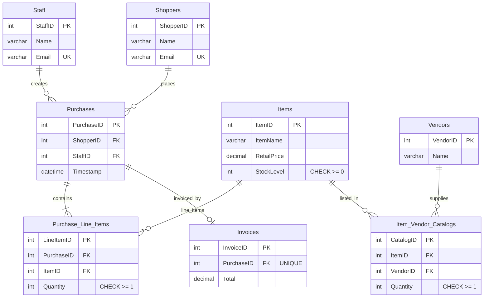

# Retail Domain — ER Diagram (Phase 0 sketch)

Whiteboard-equivalent sketch of the 8-table retail schema from Yuan 2026 (plan Phase 7A). This is the Phase 0 domain sketch; the physical DDL with full constraint syntax lands in Phase 7A.

Notes:

- `CHECK (StockLevel >= 0)` on `Items` backs optimizer rule R2/R2b.
- `UNIQUE (Email)` on `Shoppers` backs rule R1.
- `Purchases.ShopperID → Shoppers.ShopperID` (FK + NOT NULL) backs rules R3/R4.
- `ON DELETE RESTRICT` on shopper→purchases; other delete rules decided in Phase 7A.
